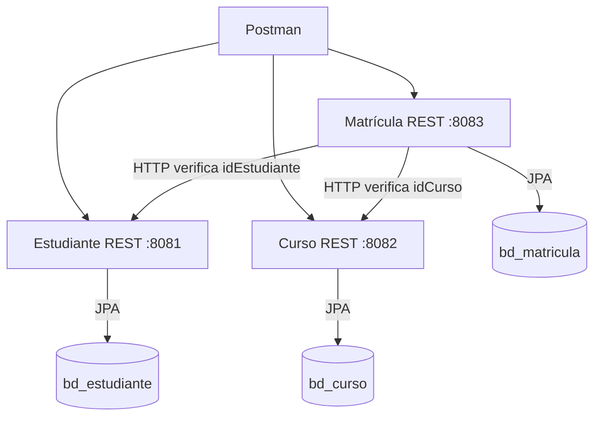

# Arquitectura de matrícula académica

Cada aplicación se inicia y se detiene de forma independiente. Un mismo servidor MySQL de XAMPP aloja tres bases; cada servicio accede únicamente a la suya.

El diagrama también está disponible como imagen vectorial en `arquitectura.svg`.

Estudiante administra identidad y contacto académico. Curso administra el catálogo, los créditos y las vacantes. Matrícula registra la asociación por IDs, fecha y estado. Los servicios se comunican mediante API, sin compartir tablas, entidades JPA ni claves foráneas entre bases.

Una matrícula no se guarda si falla la validación de sus campos o si sus referencias no existen. Si el servicio remoto está detenido, se devuelve 503. La verificación remota no garantiza consistencia ante eliminaciones concurrentes o posteriores; no se implementan transacciones distribuidas en este laboratorio.
